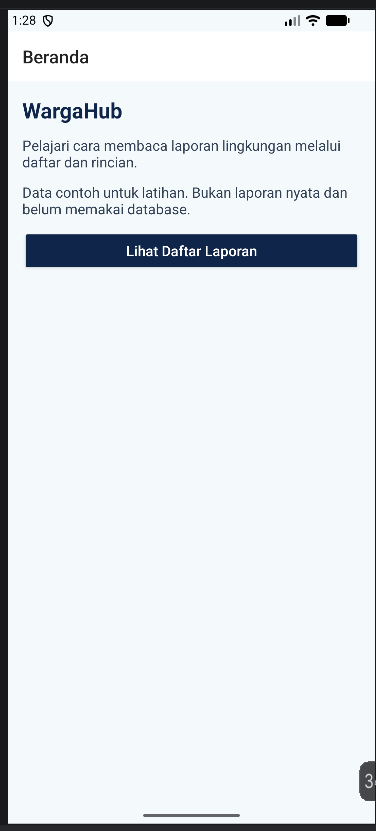
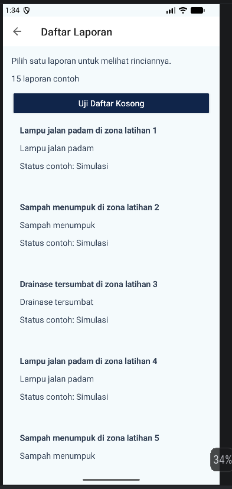
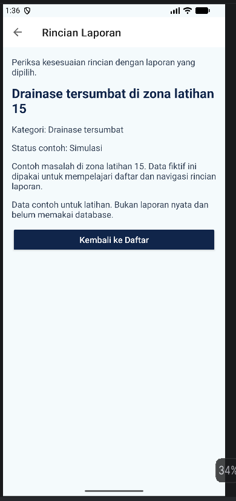
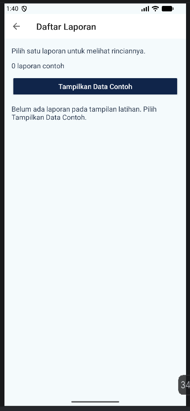
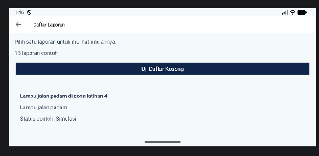
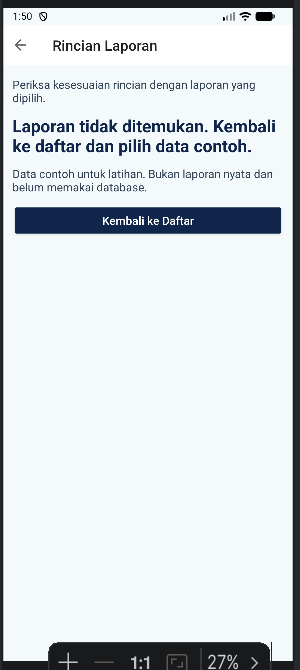

# Laporan Praktikum 04: UX, RecyclerView, Fragment, dan Navigasi (WargaHub P04)

**Mata Kuliah:** Praktikum Pemrograman Mobile (PTI23043)  
**Semester / Pertemuan:** Semester V / Pertemuan 4 (Praktikum 04)  
**Dosen Pengampu:** Muhayat, M.IT  
**Program Studi:** Teknologi Informasi, UIN Antasari Banjarmasin  

---

## 1. Identitas Mahasiswa & Informasi Proyek

* **Nama Mahasiswa:** M Naufal Akma
* **NIM:** 240104040132
* **Nama Proyek:** `WargaHubP04`
* **Package Name:** `id.antasari.p04.wargahub`
* **Bahasa & Platform:** Native Android Kotlin, Views, ViewBinding, Navigation Component
* **Target Environment:** Minimum SDK API 26 (Android 8.0 Oreo), Compile SDK API 36

---

## 2. Ringkasan Aplikasi & Alur Navigasi

Aplikasi **WargaHub P04** menerapkan arsitektur *Single-Activity* (`MainActivity`) dengan 3 *Fragment* utama:
1. **Beranda (`HomeFragment`):** Tampilan awal yang menyajikan informasi pengantar dan panduan aplikasi.
2. **Daftar Laporan (`ListFragment`):** Layar yang memuat 15 laporan fiktif menggunakan `RecyclerView` dan `ListAdapter`. Pada layar ini terdapat pengujian *empty state* ("Uji Daftar Kosong") serta tombol pemulihan data.
3. **Rincian Laporan (`DetailFragment`):** Tampilan detail yang menerima argumen ID laporan bertipe `Long` untuk menampilkan informasi lengkap dari entitas terpilih. Layar ini juga dibekali mekanisme penanganan keselamatan bila ID laporan tidak ditemukan.

### Alur Navigasi Utama:
$$\text{Beranda (HomeFragment)} \longrightarrow \text{Daftar Laporan (ListFragment)} \longrightarrow \text{Rincian Laporan (DetailFragment)}$$

---

## 3. Bukti Pengujian Visual (Screenshots)

Berikut adalah 6 bukti tangkapan layar pengujian aplikasi yang diunggah dari lingkungan eksekusi emulator/perangkat:

| No | Nama Screenshot | Deskripsi Pengujian | Tampilan UI |
| :---: | :--- | :--- | :---: |
| 1 | `01_beranda_WH04.png` | Tampilan awal `HomeFragment` memuat judul WargaHub, edukasi data contoh, dan tombol *Lihat Daftar Laporan*. |  |
| 2 | `02_daftar_WH04.png` | Layar `ListFragment` menampilkan 15 data fiktif pada `RecyclerView` beserta jumlah data dan tombol pengujian. |  |
| 3 | `03_rincian_WH04.png` | Layar `DetailFragment` menampilkan informasi rincian lengkap dari item zona latihan 15 yang dipilih. |  |
| 4 | `04_kosong_WH04.png` | Pengujian *Empty State* saat tombol *Uji Daftar Kosong* ditekan. `RecyclerView` tersembunyi dan pesan kosong tampil. |  |
| 5 | `05_landscape_fontbesar_WH04.png` | Uji layar pada orientasi **Landscape** (horisontal) untuk memastikan antarmuka tetap responsif dan lancar digulir. |  |
| 6 | `06_id_tidak_ditemukan_WH04.png` | Uji penanganan argumen ID tidak valid (`-99L`). Menampilkan pesan keselamatan tanpa terjadi crash. |  |

---

## 4. Matriks Hasil Pengujian Skenario (T01 – T16)

| ID Uji | Kondisi & Skenario Aksi | Hasil yang Diharapkan | Hasil Aktual | Status |
| :---: | :--- | :--- | :--- | :---: |
| **T01** | Buka aplikasi dari launcher | Beranda dan penjelasan data contoh tampil | Beranda tampil sempurna dengan teks edukasi data simulasi | **Lulus** |
| **T02** | Tekan *Lihat Daftar Laporan* | Menampilkan 15 laporan pada `RecyclerView` | Layar Daftar terbuka, menampilkan 15 item laporan fiktif | **Lulus** |
| **T03** | Gulir daftar hingga item 10–15 | Daftar bergulir lancar dan item bawah dapat diklik | `RecyclerView` responsif digulir hingga item paling bawah | **Lulus** |
| **T04** | Pilih item laporan tertentu (zona 15) | Rincian tampil sesuai dengan ID yang dipilih | Layar rincian menampilkan judul, kategori, dan deskripsi zona 15 | **Lulus** |
| **T05** | Tekan tombol *Kembali ke Daftar* | Kembali ke daftar tanpa membuat instance layar baru | Kembali ke `ListFragment` tanpa duplikasi layar pada back stack | **Lulus** |
| **T06** | Tekan tombol Up pada Toolbar | Navigasi mundur: Rincian $\rightarrow$ Daftar $\rightarrow$ Beranda | Ikon Up navigasi bekerja sesuai hirarki Navigation Graph | **Lulus** |
| **T07** | Tekan tombol Back sistem | Mengikuti urutan back stack tanpa crash | Navigasi Back sistem berjalan normal hingga keluar aplikasi | **Lulus** |
| **T08** | Tekan tombol *Uji Daftar Kosong* | Jumlah data 0, `RecyclerView` sembunyi, pesan kosong tampil | Tampilan *Empty State* muncul, tombol berubah jadi *Tampilkan Data Contoh* | **Lulus** |
| **T09** | Tekan tombol *Tampilkan Data Contoh* | Jumlah data kembali 15 dan item muncul lagi | Data pulih menjadi 15 laporan dan `RecyclerView` kembali tampil | **Lulus** |
| **T10** | Putar perangkat (Landscape) pada Rincian | Data rincian dan ID laporan tetap bertahan | Orientasi berubah mulus, data rincian tidak tereset | **Lulus** |
| **T11** | Putar perangkat (Landscape) pada mode Kosong | Status mode kosong dan label tombol tetap konsisten | State `contohKosong` dipertahankan via `onSaveInstanceState` | **Lulus** |
| **T12** | Uji Landscape & Font besar | Teks tetap rapi, tidak terpotong, dan dapat digulir | Konten UI menyesuaikan lebar layar landscape dan dapat di-scroll | **Lulus** |
| **T13** | Penelusuran Screen Reader (TalkBack) | `contentDescription` dibaca sebagai 1 unit bermakna | Accessible item row dibaca utuh per item oleh TalkBack | **Lulus** |
| **T14** | Ketukan cepat (Double Tap) pada item | Tidak crash dan tidak membuat navigasi ganda | Pemeriksaan `currentDestination` mencegah crash duplikasi action | **Lulus** |
| **T15** | Restart aplikasi dari launcher | Data contoh terinisialisasi ulang dari kode | Aplikasi terbuka segar di Beranda dan data contoh siap diakses | **Lulus** |
| **T16** | Uji ID tidak ditemukan (`-99L`) | Menampilkan pesan keselamatan tanpa crash | Tampil pesan *"Laporan tidak ditemukan"* dan tombol Kembali aktif | **Lulus** |

---

## 5. Pertanyaan Refleksi & Pembahasan Konsep

1. **Mengapa RecyclerView lebih sesuai dibanding menyusun TextView secara manual?**  
   *Jawab:* `RecyclerView` menggunakan mekanisme *View Recycling*. Tampilan item baris yang tidak terlihat di layar dihancurkan/didaur ulang untuk diisi oleh data baru saat digulir. Hal ini menghemat alokasi memori CPU dan RAM secara dramatis dibandingkan membuat puluhan `TextView` statis yang dapat menyebabkan masalah *Out Of Memory* (OOM).

2. **Apa perbedaan tanggung jawab Adapter, ViewHolder, dan LayoutManager?**  
   * **Adapter:** Bertindak sebagai jembatan yang menghubungkan dataset dengan `RecyclerView`, serta mengatur siklus hidup pembuatan dan pengikatan data (`onCreateViewHolder` & `onBindViewHolder`).
   * **ViewHolder:** Menyimpan referensi tampilan View dari satu baris item (menggunakan `ViewBinding`) agar terhindar dari pemanggilan `findViewById` secara berulang.
   * **LayoutManager:** Mengatur orientasi dan tata letak susunan item visual di layar (misalnya `LinearLayoutManager` untuk daftar vertikal).

3. **Mengapa ViewBinding pada Fragment harus dilepas (`null`) di `onDestroyView()`?**  
   *Jawab:* Siklus hidup (*lifecycle*) View milik Fragment terpisah dari siklus hidup instance Fragment itu sendiri. Ketika Fragment berada di *back stack*, View-nya dihancurkan tetapi instance Fragment tetap hidup di memori. Jika `_binding` tidak di-null-kan di `onDestroyView()`, referensi ke View akan tertahan dan mengakibatkan kebocoran memori (*memory leak*).

4. **Mengapa pengiriman argumen navigasi menggunakan ID lebih tepat daripada posisi baris (*position*)?**  
   *Jawab:* Indeks/posisi baris bersifat relatif dan rentan berubah bila terjadi penyaringan, pengurutan, atau penghapusan item. Mengirimkan ID unik bertipe `Long` menjamin entitas yang dicari pada layar rincian selalu tepat dan konsisten.

5. **Apa risiko jika tombol Kembali menggunakan `navigate()` menuju ke daftar baru?**  
   *Jawab:* Penggunaan `navigate()` alih-alih `navigateUp()` atau `popBackStack()` akan menumpuk instance `ListFragment` baru di atas *back stack*. Ini berisiko menyebabkan kebocoran memori dan merusak alur tombol Back sistem HP (pengguna harus menekan Back berulang kali untuk keluar aplikasi).

6. **Apa perbedaan data contoh di aplikasi ini dengan penyimpanan permanen (Database)?**  
   *Jawab:* Data contoh (`LaporanContoh`) disimpan secara sementara di memori RAM (*in-memory dataset*). Jika proses aplikasi dihentikan total dan dibuka kembali, data akan diinisialisasi ulang dari awal. Penyimpanan database (seperti Room/SQLite) menyimpan data ke memori fisik perangkat sehingga penambahan atau perubahan data tetap bertahan secara permanen.

---

## 6. Struktur Folder Pengumpulan

```text
P04_240104040132_M_Naufal_Akma/
├── WargaHubP04/                   <-- Root Project Android Studio
│   ├── app/
│   │   ├── build.gradle.kts
│   │   └── src/main/java/id/antasari/p04/wargahub/
│   │       ├── MainActivity.kt
│   │       ├── adapter/LaporanAdapter.kt
│   │       ├── data/
│   │       │   ├── Laporan.kt
│   │       │   └── LaporanContoh.kt
│   │       └── ui/
│   │           ├── DetailFragment.kt
│   │           ├── HomeFragment.kt
│   │           └── ListFragment.kt
├── README.md                      <-- Dokumentasi Markdown ini
├── docs/
│   └── Laporan_P04.pdf            <-- Dokumentasi Laporan Praktikum
└── screenshots/
    ├── 01_beranda_WH04.png
    ├── 02_daftar_WH04.png
    ├── 03_rincian_WH04.png
    ├── 04_kosong_WH04.png
    ├── 05_landscape_fontbesar_WH04.png
    └── 06_id_tidak_ditemukan_WH04.png
```